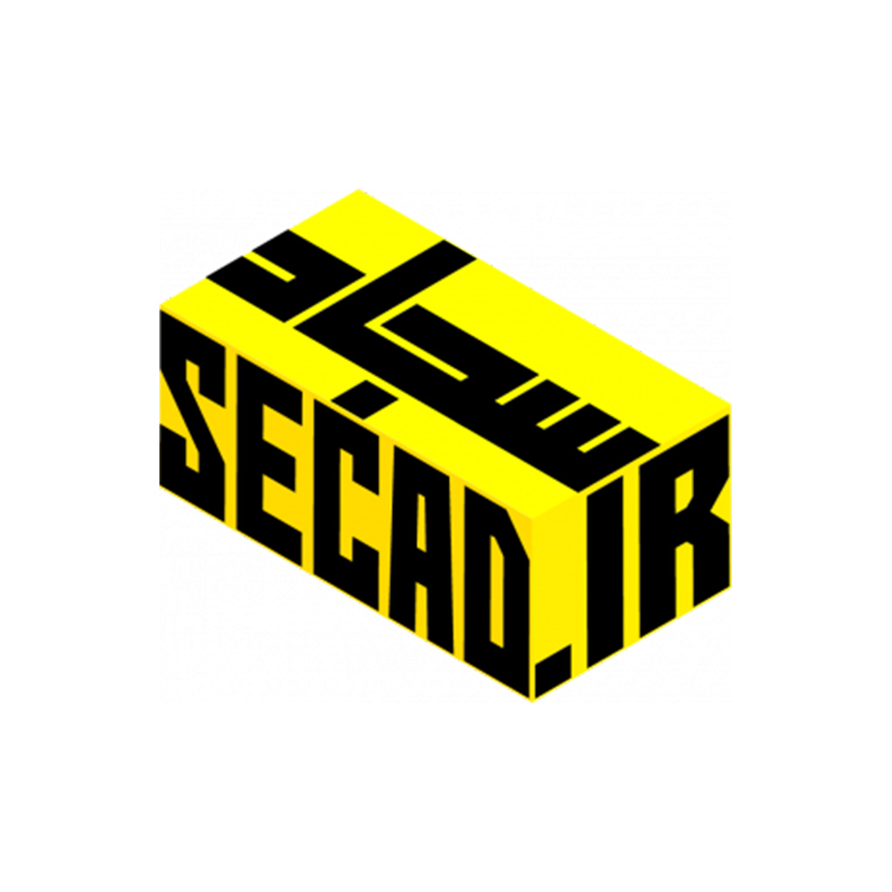

<div align="center">
  
  <!-- لوگوی شما (فایل را در ریشه پروژه قرار دهید) -->
  

  # 🎓 MyClass (سامانه مدیریت هوشمند کلاس)
  
  - **A Comprehensive Smart Classroom Management System for Vocational Schools**
  - **یک سیستم جامع و مدرن مدیریت آموزشی برای هنرستان‌ها و مدارس**

  [](https://laravel.com)
  [](https://php.net)
  [](https://mysql.com)
  [](https://getbootstrap.com)
  [](LICENSE)

</div>

---

## 📖 درباره پروژه (About The Project)

سامانه **MyClass** یک پلتفرم جامع و اختصاصی است که برای رفع نیازهای آموزشی و مدیریتی مدارس و هنرستان‌های فنی و حرفه‌ای و کاردانش طراحی و توسعه داده شده است. این سیستم با تمرکز بر سهولت استفاده برای معلمان و دانش‌آموزان، فرآیندهای آموزشی را از حالت سنتی به سمت دیجیتال و هوشمند سوق می‌دهد.

این پروژه با استفاده از فریم‌ورک قدرتمند **Laravel** و با رعایت استانداردهای امنیتی و طراحی واکنش‌گرا (Responsive) پیاده‌سازی شده است.

---

## ✨ امکانات کلیدی (Key Features)

- **📅 سیستم جامع حضور و غیاب:** ثبت دقیق حضور، غیبت و تاخیر در جلسات کلاس (با پشتیبانی از چند زنگ در یک روز برای دروس کارگاهی).
- **⭐ امتیازدهی و مدیریت رفتار:** ثبت امتیازات مثبت و منفی برای فعالیت‌های کلاسی، تکالیف و رفتارهای انضباطی.
- **📝 آزمون‌های آنلاین و امن:** برگزاری آزمون‌های چهارگزینه‌ای با تایمر هوشمند، تصادفی‌سازی سوالات و سیستم ضد تقلب (تشخیص تغییر تب، اجباری شدن تمام‌صفحه و ثبت خودکار در صورت خروج).
- **📚 سیستم تمرین و تکلیف:** ارسال تمرین‌های متنی و کدنویسی توسط دانش‌آموزان و تصحیح آنلاین توسط معلم با قابلیت مشاهده کدهای رنگی (Syntax Highlighting).
- **📊 گزارش‌گیری پیشرفته:** تولید کارنامه فردی برای دانش‌آموزان، گزارش کلاسی، رتبه‌بندی و خروجی چاپی (PDF) با پشتیبانی کامل از تقویم شمسی.
- **👥 مدیریت چند سطحی نقش‌ها:** دسترسی‌های تفکیک‌شده برای مدیرکل، معلم/هنرآموز، دانش‌آموز و مسئول مدرسه (ناظر).
- **🔐 امنیت بالا:** ثبت لاگ ورود کاربران و سیستم هوشمند بازنشانی رمز عبور.

---

## 📸 تصاویر محیط برنامه (Screenshots)

*(برای حرفه‌ای‌تر شدن، می‌توانید چند تصویر از صفحات مختلف سایت را در پوشه `docs` قرار داده و در این بخش نمایش دهید).*

| پنل مدیریت | پنل دانش‌آموز | گزارش‌گیری و کارنامه |
|:---:|:---:|:---:|
| *(تصویر درج شود)* | *(تصویر درج شود)* | *(تصویر درج شود)* |

---

## 🛠 تکنولوژی‌های استفاده شده (Tech Stack)

- **Backend:** Laravel (PHP 8.4)
- **Frontend:** Blade, Bootstrap 5 (RTL), Vanilla JavaScript, Prism.js
- **Database:** MySQL
- **Tools:** Git, Vite

---

## 🚀 نصب و راه‌اندازی (Installation)

- برای راه‌اندازی این پروژه در محیط لوکال، مراحل زیر را دنبال کنید:

```bash
# 1. Clone the repository
git clone https://github.com/secad135/myClass-app.git
cd myClass-app

# 2. Install PHP dependencies
composer install

# 3. Install NPM dependencies (for frontend assets)
npm install
npm run build

# 4. Create .env file and generate key
cp .env.example .env
php artisan key:generate

# 5. Configure your database in .env and run migrations
php artisan migrate --seed

# 6. Run the server
php artisan serve
```

---

## 👨‍💻 توسعه‌دهنده و ارتباط با من (Author & Contact)

این پروژه به صورت اختصاصی توسط **سجاد اسماعیلی** طراحی و توسعه یافته است.

- **Name:** Sajjad Esmaili (سجاد اسماعیلی)
- **Role:** Software Engineer & Official Vocational Teacher (مهندس نرم‌افزار و هنرآموز رسمی آموزش و پرورش)
- **Organization:** Education Department of Razavi Khorasan, Dargaz County (آموزش و پرورش خراسان رضوی، شهرستان درگز)
- **Website:** [secad.ir](https://secad.ir)
- **Email:** [me@secad.ir]
<!-- - **LinkedIn:** [linkedin.com/in/your-profile](https://linkedin.com) -->
- **GitHub:** [@secad135](https://github.com/secad135)

---

## 📄 مجوز (License)

این پروژه تحت مجوز **MIT** منتشر شده است. برای اطلاعات بیشتر فایل [LICENSE](LICENSE) را مطالعه کنید.

<div align="center">
  <sub>ساخته شده با ❤️ برای ارتقای سطح آموزش فنی و حرفه‌ای</sub>
</div>